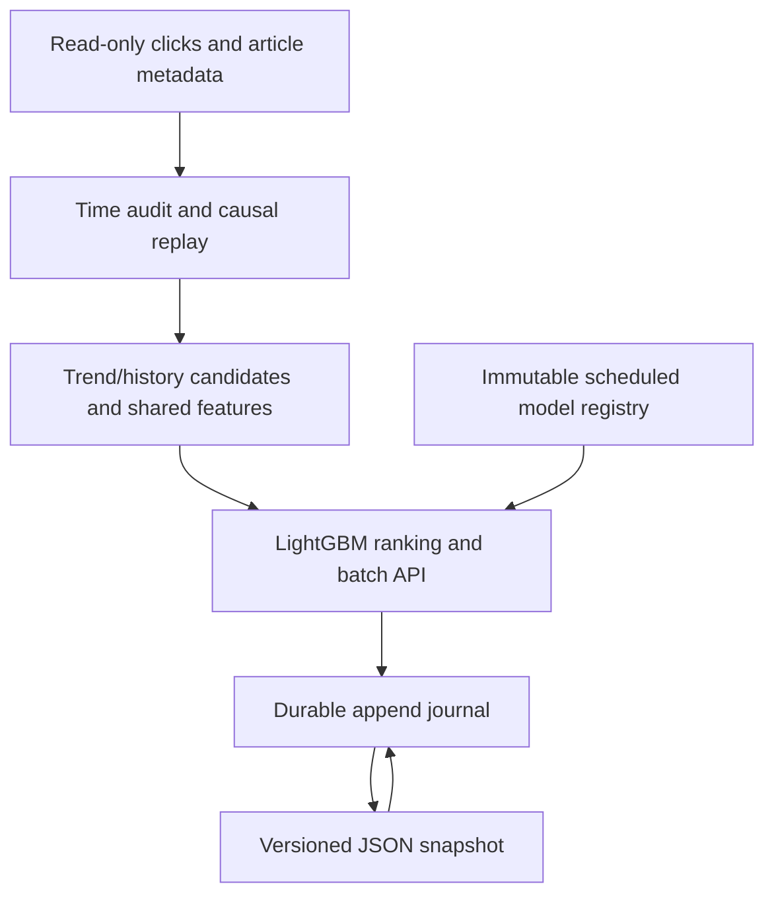

# NewsRec Replay

**Causal news ranking. Auditable model refresh. Recoverable replay.**

[](https://www.python.org/)
[](LICENSE)

[Quick start](#quick-start) · [Architecture](#architecture) · [Evidence](#evidence) · [Documentation](docs/README.md) · [中文导读](docs/README.zh-CN.md)

An independently rebuilt, CPU-based news recommendation project using **1.11 million training clicks and 364,047 articles**. It connects chronological data checks, candidate generation, LightGBM ranking and scheduled model replay to a FastAPI interface with durable logs and safe state snapshots.

The project studies what a recommender could know at each event time, how model updates affect held-out quality, and how replay can resume with identical outputs after a restart. Neural retrieval, sequence models, cold candidates and ANN are documented research branches.

## Quick start

Python **3.12**, Linux or macOS. No competition data or model download is needed for the demo.

```bash
git clone https://github.com/Keke946/newsrec-replay.git
cd newsrec-replay
python3 -m venv .venv
source .venv/bin/activate
python -m pip install -r requirements-service.txt
python tools/check_v1.py --report acceptance.json
python tools/demo_v1.py --output demo-output
```

The synthetic demo creates two toy models, activates a scheduled model update, writes a journal and snapshot, restarts, and verifies an exact retry. It demonstrates system behavior; it does not measure recommendation quality. Use a new output directory for each run.

For authorized real data and archived models, see the [reproduction guide](docs/V1_REPRODUCIBILITY.md).

## Architecture



| Layer | Responsibility | Entry point |
|---|---|---|
| Data and evaluation | Input hashes, time anomalies, full request denominators | `run.py`, `src/newsrec/data.py` |
| Candidates and ranking | Causal trend/history pool; shared 15-feature LambdaRank | `src/newsrec/time_ranker.py` |
| Model replay | Versioned registry, label-time cutoffs and scheduled activation | `src/newsrec/refresh_replay.py` |
| API and persistence | Timestamp batches, durable replies and recovery | `src/newsrec/refresh_api.py`, `src/newsrec/append_refresh_journal.py` |
| State snapshots | Prefix-bound JSON/gzip checkpoints, validation and fallback | `src/newsrec/state_snapshot.py` |

**Stack:** Python · NumPy · LightGBM · FastAPI · SQLite for source auditing · GitHub Actions.

The API is a single-owner replay service using precomputed models. It does not run a live feedback-training worker. Every source click advances the query clock, and same-time clicks are revealed after queries. Actual ingestion delays are unknown; label arrival is modeled from event timestamps.

## Evidence

Quality and systems results have different scopes:

| Check | Recorded result | Scope |
|---|---|---|
| Locked final quality | Fixed HR@5 **29.3386%**; preselected 6h refresh **29.3325%** | 114,477 requests; net −7 hits; user-cluster interval crosses zero |
| Replay parity | **114,855 / 114,855** outputs matched | Validation Top10 order, history and model cutoff |
| Durable replay | **16,315** real requests; **2** restarts | 22,158 committed batches across a model switch |
| Snapshot recovery | **30.58s → 8.75s** observed restore time | One paired real-prefix check; exact state and 103 subsequent responses |
| Local acceptance | **102 passed**, zero skips | Scoped v1 suite; independently checked from the exported source |

**Final quality did not improve.** Earlier development and validation gains did not generalize. The final protocol was locked before scoring; parameters, windows and samples were not changed afterward. Engineering results stand separately from recommendation quality.

See [full results](docs/V1_RESULTS.md) for denominators, uncertainty, training reuse and timing boundaries. Local checks do not imply a remote CI run or production SLA.

## Repository guide

| Directory | What to find |
|---|---|
| `src/newsrec/` | Shared evaluation, ranking, replay and persistence implementation |
| `tools/` | Experiment runners, independent verifiers, acceptance and demo commands |
| `tests/` | Core contract checks and research tests; the v1 runner declares its scope |
| `protocols/` | Frozen experiment and final-evaluation definitions |
| `reports/v1/` | Aggregate final results and verification records |
| `docs/` | Project map, reproduction, results, limitations and licensing |

Start with the [documentation index](docs/README.md), then follow the [project map](docs/V1_OVERVIEW.md). The [limitations](docs/V1_LIMITATIONS.md) document also records unsuccessful research and rejected persistence experiments.

## Data, provenance and license

Competition data, supplied embeddings, weights, per-request records and purchased tutorial material are excluded. Obtain authorized data separately. The selected v1 policy does not use supplied embeddings.

The new implementation is released under [MIT](LICENSE); that license does not grant rights to upstream datasets or third-party material. Background includes the [Tianchi Top2 reference implementation](https://github.com/LogicJake/tianchi-news-recommendation). Its competition rank is an upstream result, not a result achieved by this project. See [data and licensing boundaries](docs/DATA_AND_LICENSE.md).

This is an initial public source release. The [development record](docs/DEVELOPMENT_RECORD.md) describes actual earlier private work; it does not claim past GitHub uploads.
